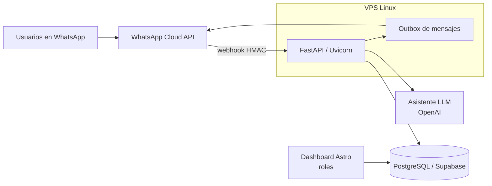

# BOT-MANTENCION-DE-DRONES-LINKAPSIS

**Bot de WhatsApp con asistente LLM para la mantención de una flota de drones**

> 🔒 **Código privado.** Este repositorio es un *showcase*: documenta el problema, la solución y la arquitectura. El código fuente pertenece a un proyecto profesional y no se publica. No incluye datos reales, credenciales ni información de clientes.

## English summary
A production WhatsApp bot plus web dashboard that manages maintenance work orders for a fleet of ~24 drones across field, logistics, office, workshop and warehouse stages. FastAPI + WhatsApp Cloud API + PostgreSQL/Supabase, an LLM conversational assistant (OpenAI in production) and 569 automated tests. In production since September 2026.

## Problema
La mantención de los drones de operación se coordinaba por mensajes sueltos y planillas: no había trazabilidad de cada equipo entre terreno, logística, oficina, taller y bodega, ni un registro único de documentos por etapa.

## Solución
- Bot de **WhatsApp** donde cada participante reporta y avanza **órdenes de trabajo (OT)** por etapa, en lenguaje natural.
- **Asistente conversacional sobre LLM** (OpenAI en producción; modelos locales con Ollama solo para pruebas) que interpreta mensajes y los traduce a acciones estructuradas.
- Documentos y evidencias por fase.
- **Dashboard web** con login y roles para seguimiento de la flota y gestión de usuarios.
- Robustez: verificación HMAC de webhooks, control de concurrencia, outbox y respaldos.

## Arquitectura

Despliegue: VPS Linux con systemd + Nginx; dashboard en Vercel.

## Stack
Python 3.11 · FastAPI · WhatsApp Cloud API · PostgreSQL/Supabase · Astro/TypeScript · OpenAI API · Ollama (pruebas) · Docker (pruebas de concurrencia) · systemd/Nginx · pytest

## Métricas verificadas
| Indicador | Valor |
|---|---|
| Drones gestionados | ~24 |
| Tests automatizados | 569 pasando |
| En producción | desde septiembre 2026 |

## Capturas
<!-- TODO: captura anonimizada del dashboard (sin nombres ni teléfonos) -->

<!-- TODO: captura de conversación de ejemplo con datos ficticios -->

## Autor
Tito Ruiz Haros · [github.com/titoruizh](https://github.com/titoruizh)
